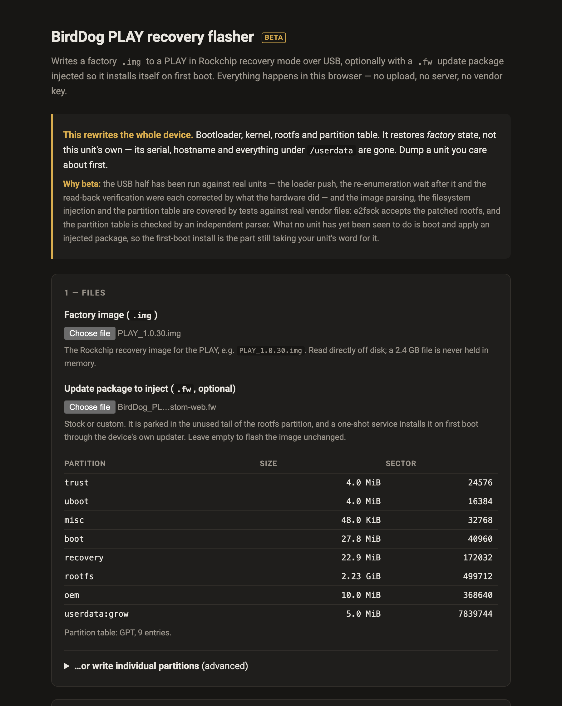

# BirdDog PLAY recovery flasher user guide

A static web page that flashes a BirdDog PLAY in Rockchip recovery mode over USB, straight from
the browser, and can also inject a `.fw` update package into the image so the device installs
it on first boot.

There's no upload, no server and no vendor key. **You supply your own factory `.img`** (BirdDog
host them in their [PLAY Reimage Process](https://birddogaus-my.sharepoint.com/personal/jessicaf_birddog_tv/_layouts/15/onedrive.aspx?id=%2Fpersonal%2Fjessicaf%5Fbirddog%5Ftv%2FDocuments%2FRecovery%20Tools%2FPLAY%20%26%20PLAY%20Pro%2FPLAY%20Reimage%20Process&ga=1)
folder on OneDrive, behind a Microsoft sign-in), and the loader that gets pushed over USB is
extracted from that file in the browser at run time.

> **Before you use this on a unit you care about: it's partly proven on a real PLAY, not
> fully.** The image parsing, the filesystem injection and the partition table are covered by
> tests against genuine vendor files. The USB half was written from rkdeveloptool's protocol and
> has since been corrected against a real unit (2026-08-15): the loader push, the
> re-enumeration wait after it, and read-back verification all changed because of what the
> hardware did. That device reads back a fill pattern rather than data above a certain sector,
> so verification now reports anything past that ceiling as *not verified* instead of calling it
> corrupt. **What no unit has been seen to do yet is boot and apply an injected `.fw`.** The
> first-boot install is the one part still unproven.
>
> This codebase was created with AI assistance, directed and reviewed by a human author.

---

## You probably do not need this

**To update a working PLAY, use the device's own web interface.** Browse to the unit's IP address,
log in, go to the **System** tab, and upload the `.fw` there. The device installs it and reboots.

This tool is for when that isn't an option: **a unit that won't boot**, or one you've
decided to put a different OS on.

---

## Getting a PLAY into recovery mode

**The recovery button isn't on the outside of the case. It sits inside the 3.5 mm headphone
socket.** Straighten a paperclip or use a SIM-eject tool, push it gently all the way in, and
you'll feel the button click.

1. Power the unit off.
2. Push the pin into the headphone socket and **hold the button down**.
3. Still holding it, apply power, and **keep holding for a few seconds after**.
4. Connect USB, then release.

The unit enumerates in either **maskrom** or **loader** mode, and the page reports which and
handles both.

**If it boots normally instead, the button wasn't held down far enough or long enough.** The
socket is deep and the button is right at the bottom.

**Windows** needs [Zadig](https://zadig.akeo.ie/) to rebind the device to WinUSB, because
Rockchip's own driver claims it and the browser can't reach it after that. **macOS needs
nothing.** Linux needs a udev rule.

---

## The four things it can do

| | |
|---|---|
| **Flash a factory `.img`** | Whole device: bootloader, u-boot, trust, kernel, DTB, rootfs, partition table. **The brick-recovery path.** |
| **Inject a `.fw`** | Parks the package in the unused tail of the rootfs partition and adds a one-shot service that installs it on first boot via the device's own updater. |
| **Write individual partitions** | The opposite job: put a **replacement OS** on a unit, writing only the partitions you name and leaving the rest — including the vendor's recovery partition — untouched. |
| **Verify** | Optional read-back and compare of everything written. |

The image is read off disk in slices and **never held in memory**, so choosing a 2.3 GB file costs
nothing.

---

## Writing individual partitions

Restoring a factory image and installing a replacement OS are different jobs, and this does
the second. Give it one file per partition and it writes those and nothing else.

Two things make it safer than the `dd`-at-an-offset it replaces:

- **It aims using the partition table read off the device**, not a sector number copied out of a
  parameter file. A number in a script is right until it meets a unit that's already been
  reflashed, or isn't a PLAY at all, **and that's the very case where a 3.5 GiB write at a
  plausible offset does real damage.** The table is read, the header checksum verified, partitions
  matched by name, and **a file too large for its target is refused rather than truncated.**
- **`uboot`, `trust` and `recovery` are refused by default.** They're what loader mode and the
  vendor's restore depend on. You can write them, but **only by ticking an override on
  purpose**, because getting them wrong is the difference between "flash it again" and "this
  unit is gone".

It needs the device in **loader mode**: a maskrom device can't serve the reads used to fetch the
partition table until a loader has been pushed into it, and **the loader comes out of a factory
image.**

Everything not listed is left just as it was, and that's what keeps the factory recovery path
there for you after you've replaced the OS.

---

## Why injection works

A `.fw` isn't a partition image. It's an archive whose installer script **runs as root on a
booted device**, and in maskrom mode there's no OS to run it, so it can't just be flashed.

Two facts from the factory image make the injection clean:

- **The rootfs partition has a 1.26 GiB hole.** The partition is 3.5 GiB and the filesystem image
  is 2.235 GiB, and **nothing ever grows into it**: only the userdata partition grows. The package
  lives there as raw bytes, costing no filesystem space.
- **The rootfs is plain ext2**, with no journal, no extents and no metadata checksums. So three
  small files can be added to it correctly from JavaScript, and `e2fsck` agrees.

On first boot the injected service reads the package back off the partition, hands it to the
device's own updater the same way the vendor's network path does, waits, and reboots.

**It marks itself done *before* installing**, so a package that kills the box can't reinstall
itself on every boot.

---

## If something is wrong

| Symptom | Cause |
| --- | --- |
| **The unit boots normally instead of entering recovery** | The button was not held long or far enough. The socket is deep. |
| **The browser cannot see the device (Windows)** | Rockchip's driver has claimed it. Rebind with Zadig. |
| **A partition write is refused** | Either the file is too large for its target — refused rather than truncated — or it is `uboot`, `trust` or `recovery`, which need the override. |
| **The partition table cannot be read** | The device is in maskrom mode. A loader has to be pushed first, and it comes out of a factory image. |
| **An injected package did not install** | It marks itself done before installing, deliberately. Read the device's own updater log. |
